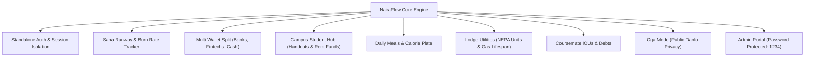
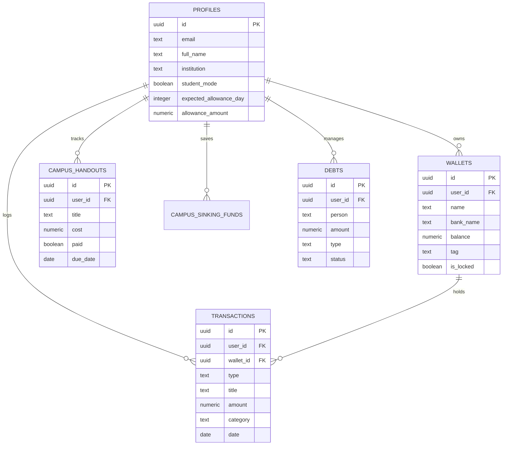

# ₦ NairaFlow • Nigerian Daily Life & Sapa Runway Tracker
### *Campus Edition Progressive Web App (PWA)*

[](https://jew825.github.io/nairaflow/)
[](https://supabase.com)
[](https://jew825.github.io/nairaflow/)

> **Live Web App**: [https://jew825.github.io/nairaflow/](https://jew825.github.io/nairaflow/)  
> **Source Repository**: [https://github.com/jew825/nairaflow](https://github.com/jew825/nairaflow)

---

## 📌 Project Overview

**NairaFlow** is an offline-first, student-centric financial survival tracker designed specifically for the unique socio-economic realities of Nigerian higher institutions (universities, polytechnics, colleges of education) and young adults.

Unlike foreign budgeting apps built around credit scores and predictable paychecks, NairaFlow focuses on:
- **Sapa Runway Calculation**: How many days you can survive before running completely broke based on your available liquid cash and daily burn rate.
- **Allowance Countdown**: Visual countdown to your next expected pocket money or home allowance transfer.
- **Campus Realities**: Tracking course handouts, departmental dues, lodge rent sinking funds, cafeteria food plates (Garri, Indomie, Rice, Egusi), and lodge NEPA power token consumption.
- **Privacy "Oga Mode"**: Instant one-click Gaussian blur masking all currency balances when checking your budget on a campus shuttle, *keke*, or *danfo* bus.
- **Dual-Layer Architecture**: Operates 100% offline with per-account local data isolation, and synchronizes to **Supabase PostgreSQL Cloud SQL** with **Row Level Security (RLS)** for multi-device cross-platform sync.

---

## 🚀 Key Modules & Capabilities



### 1. 🔐 Standalone Authentication & Privacy
- **Dedicated Login Screen**: When logged out, the dashboard, header, sidebar, and bottom navigation are completely hidden (`display: none`), replaced by a full-screen standalone login and registration page.
- **Account Data Isolation**: Data is saved to `nairaflow_user_data_<userId>` so that logging out completely clears all active views to blank `0.00` defaults, and logging back in immediately restores that account's balances and history.
- **Guest / Offline Mode**: Instant access without an account for users who want to track budgets completely offline.

### 2. 📊 Sapa Runway & Burn Rate Engine
- Calculates remaining survival runway:
  $$\text{Runway (Days)} = \frac{\text{Liquid Cash Balance}}{\text{Daily Burn Rate}}$$
- Alerts you when your burn rate threatens your survival before your next home allowance arrives.

### 3. 🏦 4-Tier Wallet System
- **Primary Commercial Bank**: GTCO, Access, Zenith, UBA, FirstBank.
- **Fintech / Daily Spends**: OPay, PalmPay, Moniepoint, Kuda.
- **Cash in Hand**: Roadside food, bike fares, Danfo, and photocopies.
- **Locked Savings**: PiggyVest SafeLock, Cowrywise (excluded from liquid runway calculations to prevent dipping into savings).

### 4. 🎓 Campus Student Survival Hub
- **Course Handouts & Departmental Dues**: Never miss an exam eligibility sticker or lecture material due to unpaid campus dues.
- **Lodge Rent & Device Sinking Funds**: Incremental target trackers for off-campus hostel rent, phone replacement, or laptop repairs.

### 5. 🍲 Nigerian Cafeteria & Food Tracker
- Preloaded with authentic Nigerian campus meals:
  - *Garri with Groundnut & Sugar*
  - *Indomie Hungryman with Fried Egg*
  - *Jollof Rice & Chicken*
  - *Eba & Egusi Soup with Beef*
  - *Bread & Beans (Ewa Aganyin)*
  - *Suya & Soft Drink*

### 6. ⚡ Lodge NEPA & Gas Lifespan Predictor
- Predicts the exact day prepaid NEPA electricity units will run out.
- Predicts cooking gas cylinder exhaustion based on cylinder size (3kg, 5kg, 6kg, 12.5kg).

### 7. 🤝 Coursemate IOU Ledger
- Tracks money lent to coursemates ("Owing Me") and money borrowed from peers ("I Owe").
- One-tap "Mark as Settled" automatically logs wallet inflows/outflows.

### 8. 🛡️ Danfo Privacy "Oga Mode"
- Tap the eye icon to blur all currency numbers across the entire screen so onlookers in public transport cannot see your balance.

### 9. 🔐 Admin Portal
- Accessed by tapping the green **₦** logo 5 times, or via the menu.
- Protected by master password (default: `1234`).
- Allows configuring or swapping Supabase Cloud database credentials without exposing keys to regular users.

---

## 🗄️ Database Architecture (PostgreSQL on Supabase)

All tables use native PostgreSQL `UUID` primary keys (`gen_random_uuid()`) and enforce strict **Row Level Security (RLS)**:



---

## 📂 Repository Structure

| File | Purpose |
| :--- | :--- |
| [`app.html`](app.html) | Master single-file source code (HTML5, CSS3, ES2022 JavaScript, Chart.js). |
| [`index.html`](index.html) | Production mirror of `app.html` deployed directly to GitHub Pages. |
| [`sw.js`](sw.js) | Network-First Service Worker (v6) with offline caching and automatic updates. |
| [`manifest.json`](manifest.json) | Progressive Web App (PWA) manifest for Android and iOS installation. |
| [`schema.sql`](schema.sql) | Full relational PostgreSQL schema with Row Level Security (RLS) policies. |
| [`README.md`](README.md) | Project documentation. |

---

## ⚙️ Development & Deployment Workflow

### 1. Synchronize Files
GitHub Pages serves `index.html`. Always ensure `app.html` and `index.html` remain identical:
```powershell
Copy-Item -Path "app.html" -Destination "index.html" -Force
```

### 2. Push to GitHub
```bash
git add app.html index.html sw.js README.md
git commit -m "Update NairaFlow features and documentation"
git push origin main
```

### 3. Setup Supabase Backend
1. Create a Supabase project at [supabase.com](https://supabase.com).
2. Run the SQL script located in [`schema.sql`](schema.sql) inside the Supabase **SQL Editor**.
3. In **Authentication &rarr; Providers &rarr; Email**, toggle **OFF** *"Confirm email"* to allow immediate login upon registration.

---

## 📄 License
This project is open-source under the MIT License. Built with ❤️ for Nigerian students navigating campus life and beating Sapa.
